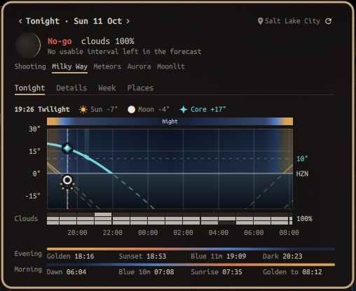

# Night sky

A bar widget for the [Omarchy](https://omarchy.org) shell, made for planning night and twilight photography.



The pill shows the next sunrise or sunset, tonight's moon phase and how long the moon-free darkness lasts. A cloud glyph appears when the dark hours are mostly clouded over, and an aurora glyph when the Kp forecast reaches your threshold. The pill is highlighted on a night rated "go".

Click it for the night panel. **Tonight** has:

- **A shoot verdict**: go, marginal or no-go, plus the factor that decides it ("No-go · clouds 95%"). It uses a worst-factor rule over the moon-free dark window. The factors that can block a night are moon-free time, mean and worst-hour cloud, haze (aerosol optical depth) and wind gusts. Dew, core altitude and the jet stream are shown as advice. Missing hourly coverage or cloud/haze forecasts older than six hours keep the night at "marginal" at best. Kp does not lower the whole-window assessment; it flags an aurora opportunity.
- **Photography modes**: Milky Way requires the core above 10° in moon-free astronomical darkness; meteors use the highest-ZHR active curated shower with its radiant above 10° in moon-free darkness; aurora uses astronomical darkness without requiring the moon to be down; moonlit landscapes use the moon above the horizon, at least 10% lit, with the sun below −6°. The mode assessment covers all target intervals, with a one-hour interval rated good and 30 minutes marginal. The core altitude gates Milky Way mode only. Meteor mode names unverified curated showers explicitly.
- **A best interval**, separate from the whole-window assessment. It searches at five-minute resolution, excludes elapsed time, and ranks intervals of at least 30 minutes by rating, then complete/fresh coverage, duration, and earlier start. It considers both clear runs and longer mixed runs, so a clear hour can win over an otherwise marginal night. The selected interval is outlined on the chart, with its cloud cover, direction and duration. Aurora intervals additionally need overlapping Kp at or above your threshold; stale Kp keeps an interval marginal. Missing weather produces a provisional interval, never a confident go.
- **A sky chart** from evening golden hour to the end of morning golden hour, coloured by the sun's altitude: golden hour (+6° to −4°), blue hour (−4° to −6°), twilight, and night. Sun, moon and Milky Way core altitude are drawn over it. The core line is bold where it is at least 10° up in moon-free dark, and a red line marks now.
- **Lanes** along the same time axis:
  - cloud by layer (high, mid, low)
  - a seeing proxy from the 250 hPa jet-stream wind
  - planetary Kp in 3-hour bins
- **Every factor** behind the whole-window verdict, coloured by its rating, plus separate update ages for clouds/wind, haze and Kp. Missing data and stale forecasts are labelled beside those sources.
- **Evening and morning times**: golden hour, sunset, blue hour, astronomical dark, dawn and sunrise.
- **Where to point**:
  - the core's best time, altitude and direction
  - its rise, highest point and set
  - where the moon rises
  - optionally, the longest exposure before stars trail, by the NPF and 500 rules, for your lens

**Week & events** has:

- **The next seven nights**: verdict colour, moon phase, moon-free hours and mean cloud. Click a night to open it. The best upcoming interval is highlighted with its duration, clouds and gusts; only complete, fresh forecasts qualify. If none qualify, the panel says so.
- **The next 30 days**:
  - moon phases, equinoxes and solstices
  - meteor showers, judged where you are: does the radiant clear 10° in darkness, how long is it up with the moon down, and is a nearby night better?
  - curated festivals

**Locations** saves named latitude, longitude and IANA time-zone entries in `~/.config/omarchy/night-sky-locations.json` (or under `XDG_CONFIG_HOME`). Use the displayed location to fill the form, or enter another destination. Reusing a name replaces it; Remove deletes that saved entry. Switch locations in the tab, or compare the displayed and saved locations for the same evening date and photography mode. All chart times and dates use each location's zone, shown in the header and comparison. The initial location still comes from widget settings or Omarchy weather. Saved locations stay out of the plugin repository.

‹ › step to other nights. The wheel scrolls long panels. Right click the pill or click the panel's refresh button to recalculate; network requests retain the hourly cache limit. Escape closes the panel. Mode/location selections last for the widget session; set their defaults in widget settings to retain them across shell restarts.

## Install

```bash
omarchy plugin add https://github.com/buschbrian/omarchy-night-sky.git --enable
```

Plugins install disabled unless you pass `--enable`, so you can read the code first. The widget lands in the right section; move it with `omarchy bar move buschbrian.night-sky --section <left|center|right>`.

To open the panel from a key, bind `omarchy-shell buschbrian.night-sky toggle`. IPC also supports `showTab 0|1|2`, `selectMode milky-way|meteors|aurora|moonlit`, `selectLocation "saved name"` (empty for the configured location), and `compare`.

The helper supports `--save-location NAME --lat LAT --lon LON --tz ZONE`, `--list-locations`, `--remove-location NAME`, `--saved-location NAME`, and `--compare-locations`. `--mode` selects the same four subjects. Comparisons reuse the forecast caches and respect `--offline`.

## Settings

| Setting | Default | |
|---|---|---|
| Latitude / Longitude | empty | Decimal degrees. Empty uses the location set in Omarchy's weather panel. |
| Photography mode | milky-way | Default subject; change it in the panel during a session. |
| Location name / Time zone | empty | Name for configured coordinates; IANA zone, e.g. America/Denver. Empty zone uses the system zone. |
| Default saved location | empty | Exact name saved in the Locations tab; empty uses configured coordinates or weather. |
| Aurora Kp | 6 | Kp that flags an aurora chance. About 6 near 40–45° latitude; lower further poleward. |
| Clouds and Kp | on | Off keeps the widget fully offline (astronomy only). |
| Lens focal length, aperture, pixel pitch, crop factor | off | For the exposure helper. Focal length alone gives the 500 rule; add aperture and pixel pitch for the NPF rule at the core's declination. |
| Refresh (minutes) | 10 | |

Times use the selected location's time zone; the system zone is the default.

## Data

- **Astronomy** is computed locally with the Python standard library: the sun from Meeus ch. 25, the moon from Meeus ch. 47 with topocentric parallax, and shower radiants precessed from J2000 (Meeus 21.2). It is checked against golden vectors from [dark-sky-shot-planner](https://github.com/buschbrian/dark-sky-shot-planner), which were generated with astronomy-engine, and against published equinox and moon-phase times.
- **Verdict thresholds** (`data/conditions-thresholds.json`) and **curated showers and festivals** (`data/sky-events.json`) come from dark-sky-shot-planner (MIT). The events list is refreshed daily from that repo; the bundled copy is the fallback.
- **Weather**: [Open-Meteo](https://open-meteo.com) hourly forecast (cloud layers, gusts, temperature, dew point, 250 hPa wind) and air quality (aerosol optical depth, about five days ahead). Your coordinates are sent with these requests. Open-Meteo's free API is for non-commercial use.
- **Kp**: [NOAA SWPC](https://www.swpc.noaa.gov) planetary K-index observations and forecast. No location is sent.

Network data is fetched at most once an hour (the events list once a day) and cached in `~/.cache/night-sky/`. Without a network, cached values remain labelled with their original fetch ages; missing values and coverage keep the verdict incomplete. Kp is a planning guide, not a local visibility prediction: darkness, clouds and a clear poleward horizon still matter.

Needs `python3`, which Omarchy ships, and a Nerd Font in the bar, which is Omarchy's default.

## Development

```bash
python3 -m unittest discover -s tests
python3 bin/night-sky --bar --lat 40.76 --lon -111.89 --date 2026-10-20 | python3 -m json.tool
omarchy plugin validate .
```

## License

MIT


Local verification includes the offline regression suite and manifest validation. Native panel checks use the running Omarchy shell; a shell restart may be needed if hot reload retains the previous QML component. Screenshots and local destinations are not committed.
